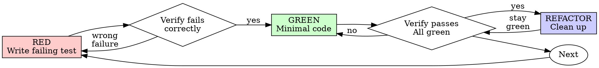

> Source: [obra/superpowers](https://github.com/obra/superpowers) `skills/test-driven-development/SKILL.md` at `2ce8aa1`,
> MIT, © 2025 Jesse Vincent, see [THIRD-PARTY-NOTICES](../THIRD-PARTY-NOTICES.md). Hearthpulse changes: examples and commands in C#/xunit and `dotnet test`; exceptions are recorded in the handover instead of stopping to ask; the "In Hearthpulse" section.

# Test-Driven Development (TDD)

## Overview

Write the test first. Watch it fail. Write minimal code to pass.

**Core principle:** If you didn't watch the test fail, you don't know if it tests the right thing.

**Violating the letter of the rules is violating the spirit of the rules.**

## When to Use

**Always:**
- New features
- Bug fixes
- Refactoring
- Behavior changes

**Exceptions (name each one in your handover, with the reason):**
- Throwaway prototypes
- Generated code (`*.g.cs` from the generators in `tools/`)
- Configuration files
- Pure XAML/AXAML layout with no logic: checked by Headless binding tests and `hearthpulse-visual-check` instead

Thinking "skip TDD just this once"? Stop. That's rationalization.

## The Iron Law

```
NO PRODUCTION CODE WITHOUT A FAILING TEST FIRST
```

Write code before the test? Delete it. Start over.

**No exceptions:**
- Don't keep it as "reference"
- Don't "adapt" it while writing tests
- Don't look at it
- Delete means delete

Implement fresh from tests. Period.

## Red-Green-Refactor



### RED - Write Failing Test

Write one minimal test showing what should happen.

<Good>
```csharp
[Fact]
public async Task Retries_failed_operations_three_times()
{
    var attempts = 0;
    Task<string> Operation()
    {
        attempts++;
        if (attempts < 3) throw new InvalidOperationException("fail");
        return Task.FromResult("success");
    }

    var result = await Retry.RunAsync(Operation);

    Assert.Equal("success", result);
    Assert.Equal(3, attempts);
}
```
Clear name, tests real behavior, one thing
</Good>

<Bad>
```csharp
[Fact]
public async Task Retry_works()
{
    var fake = new CountingFake(failures: 2, result: "success");
    await Retry.RunAsync(fake.Invoke);
    Assert.Equal(3, fake.Calls);
}
```
Vague name, tests mock not code
</Bad>

**Requirements:**
- One behavior
- Clear name
- Real code (no mocks unless unavoidable)

### Verify RED - Watch It Fail

**MANDATORY. Never skip.**

```bash
dotnet test tests/Hearthpulse.Tests/Hearthpulse.Tests.csproj --no-restore --filter "FullyQualifiedName~RetryTests"
```

Confirm:
- Test fails (not errors)
- Failure message is expected
- Fails because feature missing (not typos)

**Test passes?** You're testing existing behavior. Fix test.

**Test errors?** Fix error, re-run until it fails correctly.

### GREEN - Minimal Code

Write simplest code to pass the test.

<Good>
```csharp
public static async Task<T> RunAsync<T>(Func<Task<T>> operation)
{
    for (var attempt = 1; ; attempt++)
    {
        try
        {
            return await operation();
        }
        catch when (attempt < 3)
        {
        }
    }
}
```
Just enough to pass
</Good>

<Bad>
```csharp
public static Task<T> RunAsync<T>(
    Func<Task<T>> operation,
    int maxRetries = 3,
    BackoffKind backoff = BackoffKind.Linear,
    Action<int>? onRetry = null)
{
    // YAGNI
}
```
Over-engineered
</Bad>

Don't add features, refactor other code, or "improve" beyond the test.

### Verify GREEN - Watch It Pass

**MANDATORY.**

```bash
dotnet test tests/Hearthpulse.Tests/Hearthpulse.Tests.csproj --no-restore --filter "FullyQualifiedName~RetryTests"
```

Confirm:
- Test passes
- Other tests still pass
- Output pristine (no errors, warnings)

**Test fails?** Fix code, not test.

**Other tests fail?** Fix now.

**"Other tests" means the project's suite, not just your file.** A
green run of the test you wrote is not a green suite. Before you call
the change done, run the project's test command (the full
`tests/Hearthpulse.Tests`, plus `tests/Hearthpulse.Presentation.Tests` on
Windows when shared presentation code or a view changed; see
`hearthpulse-testing`) even when your task named only one test file. A scope statement in your task bounds the
deliverable, not your verification. Any failure that run shows —
including one you didn't cause — goes in your report by name; a red
test you watched scroll past and didn't mention is a report falsified
by omission.

### REFACTOR - Clean Up

After green only:
- Remove duplication
- Improve names
- Extract helpers

Keep tests green. Don't add behavior.

### Repeat

Next failing test for next feature.

## Good Tests

| Quality | Good | Bad |
|---------|------|-----|
| **Minimal** | One thing. "and" in name? Split it. | `test('validates email and domain and whitespace')` |
| **Clear** | Name describes behavior | `test('test1')` |
| **Shows intent** | Demonstrates desired API | Obscures what code should do |

When writing or changing any test, read [writing-good-tests.md](writing-good-tests.md) for the rules that keep tests honest:
- Name the production change that would make the test fail — before writing it
- Assert on real behavior, never on mock behavior
- Keep test-only code in test utilities, out of production classes
- Understand a dependency's side effects before mocking it

## Common Rationalizations

| Excuse | Reality |
|--------|---------|
| "Too simple to test" | Simple code breaks. Test takes 30 seconds. |
| "I'll test after" | Tests written after pass immediately — which proves nothing. They may test the wrong thing, test the implementation instead of the behavior, or miss the edge case you forgot. You never watched it fail, so you never proved it can catch the bug. Test-first forces that failure. |
| "Tests after achieve same goals (spirit not ritual)" | Tests-after answer "what does this do?"; tests-first answer "what should this do?" Tests written after are biased by the code you already wrote — you verify the cases you remembered, not the ones you'd have discovered. Coverage without proof the tests work. |
| "Already manually tested" | Manual testing is ad-hoc: no record of what you covered, no way to re-run it when the code changes, easy to forget cases under pressure. "Worked when I tried it" ≠ comprehensive. Automated tests run the same way every time. |
| "Deleting X hours is wasteful" | Sunk cost fallacy — that time is already spent either way. The real choice: rewrite with TDD (high confidence) vs. keep it and bolt tests on after (low confidence, likely bugs). Keeping code you can't trust is the waste. |
| "Keep as reference, write tests first" | You'll adapt it. That's testing after. Delete means delete. |
| "Need to explore first" | Fine. Throw away exploration, start with TDD. |
| "Test hard = design unclear" | Listen to test. Hard to test = hard to use. |
| "TDD will slow me down" | TDD IS the pragmatic path: catches bugs before commit, prevents regressions, lets you refactor without fear. "Pragmatic" shortcuts mean debugging in production — slower, not faster. |
| "Manual test faster" | Manual doesn't prove edge cases. You'll re-test every change. |
| "Existing code has no tests" | You're improving it. Add tests for existing code. |

## Red Flags - STOP and Start Over

- Code before test
- Test after implementation
- Test passes immediately
- Can't explain why test failed
- Tests added "later"
- Rationalizing "just this once"
- "I already manually tested it"
- "Tests after achieve the same purpose"
- "It's about spirit not ritual"
- "Keep as reference" or "adapt existing code"
- "Already spent X hours, deleting is wasteful"
- "TDD is dogmatic, I'm being pragmatic"
- "This is different because..."

**All of these mean: Delete code. Start over with TDD.**

## Example: Bug Fix

**Bug:** Empty email accepted

**RED**
```csharp
[Fact]
public void Rejects_empty_email()
{
    var result = SignupForm.Submit(new FormData(Email: ""));
    Assert.Equal("Email required", result.Error);
}
```

**Verify RED**
```bash
$ dotnet test ... --filter "FullyQualifiedName~SignupFormTests"
Failed Rejects_empty_email: Assert.Equal() Failure: Expected "Email required", Actual null
```

**GREEN**
```csharp
public static SubmitResult Submit(FormData data)
{
    if (string.IsNullOrWhiteSpace(data.Email))
        return new SubmitResult(Error: "Email required");
    // ...
}
```

**Verify GREEN**
```bash
$ dotnet test ... --filter "FullyQualifiedName~SignupFormTests"
Passed!
```

**REFACTOR**
Extract validation for multiple fields if needed.

## Verification Checklist

Before marking work complete:

- [ ] Every new function/method has a test
- [ ] Watched each test fail before implementing
- [ ] Each test failed for expected reason (feature missing, not typo)
- [ ] Wrote minimal code to pass each test
- [ ] All tests pass
- [ ] Output pristine (no errors, warnings)
- [ ] Tests use real code (mocks only if unavoidable)
- [ ] Edge cases and errors covered

Can't check all boxes? You skipped TDD. Start over.

## When Stuck

| Problem | Solution |
|---------|----------|
| Don't know how to test | Write wished-for API. Write assertion first. Ask the coordinator. |
| Test too complicated | Design too complicated. Simplify interface. |
| Must mock everything | Code too coupled. Use dependency injection. |
| Test setup huge | Extract helpers. Still complex? Simplify design. |

## Debugging Integration

Bug found? Write failing test reproducing it. Follow TDD cycle. Test proves fix and prevents regression.

Never fix bugs without a test.

## Final Rule

```
Production code → test exists and failed first
Otherwise → not TDD
```

No exceptions beyond the list above, and each one is named in your handover.

## In Hearthpulse

- Project specifics (fixtures, synthetic Power.log lines, fake `HttpMessageHandler`, Headless bindings, known
  failures, the Windows-only suite): [hearthpulse-testing](../hearthpulse-testing/SKILL.md).
- While working, run one class with `--filter`; build with `-m:2` (the owner plays on this PC). One full run at the
  end, and its counts go into the handover.
- A view-model behaviour that both UIs share is tested once in `src/Hearthpulse.Presentation` terms; what differs per
  UI is checked in that UI's tests.
- Where to put a seam: [codebase-design](../codebase-design/SKILL.md).
